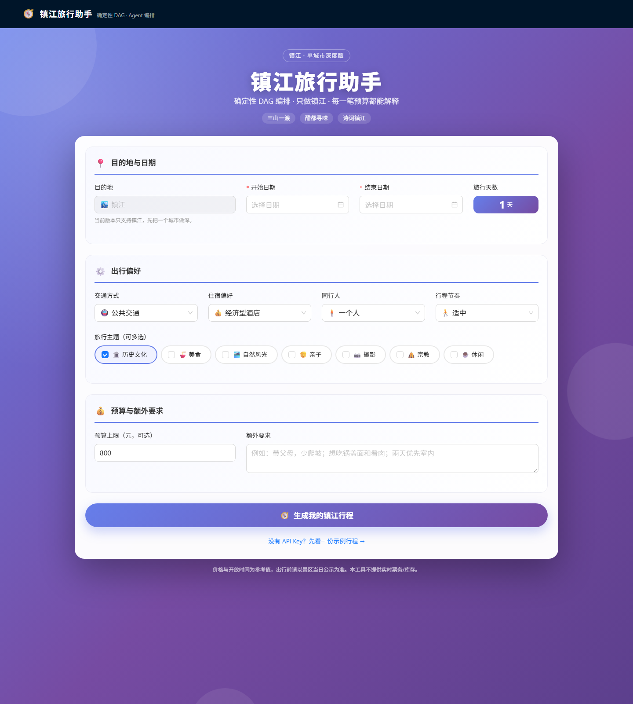
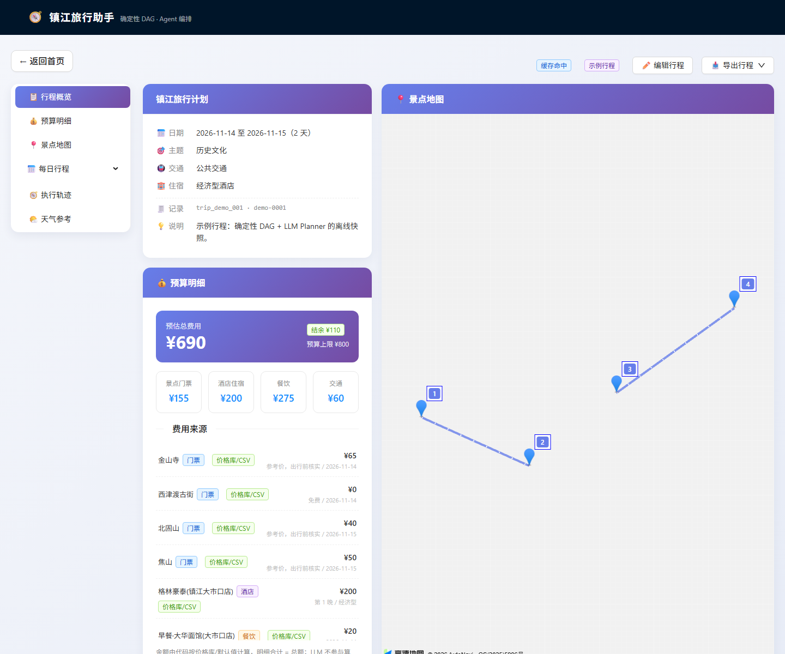
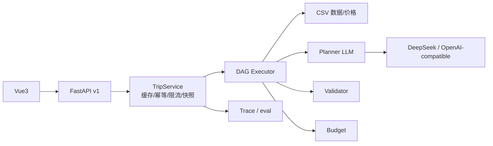

# 镇江旅行助手 · 确定性 DAG 多角色 Agent

> 一个只做镇江的旅行规划服务：**LLM 只负责在候选 ID 中做取舍，代码负责事实、约束、预算和失败语义。**





当前 `main` 已合并：

- `feature/zhenjiang-agent`：v1 主链路（DAG、Planner、Validator、Budget、API、评测）
- `feature/zhenjiang-dag`：早期三 Agent 并行原型（保留作历史对照）

---

## 30 秒了解这个项目

通用旅行规划通常是：

```text
用户输入城市 -> 一次 LLM 调用 -> 返回一段看起来合理的行程
```

它的问题不是文笔，而是不可信：

- 景点可能不存在，价格可能编造；
- 不知道闭馆日、两个点之间要多久；
- 预算四项相加对不上；
- 失败时返回假数据，而不是报错或降级；
- 同参数重新生成，结果不可复现。

这个项目换了一个思路：

```text
代码是控制面，LLM 是数据面。
Planner 只选 ID，代码展开事实、校验约束、计算预算。
失败就报错或降级，不返回假行程。
```

---

## 主链路 vs 旧链路

项目经历过一次架构收敛，面试时建议主动讲清楚，而不是把两套混在一起。

| 链路 | 用途 | 关键类/文件 |
|---|---|---|
| **v1 主链路** | 当前 API 使用 | `api/v1` → `TripService` → `DAGExecutor` → `PlannerAgent` + CSV |
| **旧三 Agent 原型** | 历史/对照，已合并保留 | `MultiAgentTripPlanner`、`AmapService`、旧 `api/routes/trip.py` |
| **旧 MySQL 价格库** | 原型阶段预算 | `BudgetCalculator`、`PriceRepository`、`price_normalizer` |

当前 v1 的核心变化：

- Planner 从“写名称/价格”收敛为“只输出 ID”；
- 预算从“LLM 估算 + 名称匹配”收敛为“代码按 ID 查价”；
- 数据从“高德 MCP 取数”收敛为“本地 CSV + 稳定 ID”；
- 失败从“默认提示兜底”收敛为“明确失败/降级，不返回假行程”。

---

## 它能做什么

输入：

```text
镇江 2 天 · 预算 800 · 历史文化 · 公共交通 · 一个人 · 节奏适中
```

输出：

- 每天 2–3 个景点，按主题/区域组织；
- 酒店、早中晚三餐；
- 门票/酒店/餐饮/交通四项预算，以及每条费用的来源；
- 天气参考、地图点位、执行 Trace；
- 编辑后可重新校验并重算预算。

没有 API Key 也能看示例：

```text
http://localhost:5173/result?demo=1
```

示例数据在 [frontend/public/demo-trip.json](frontend/public/demo-trip.json)。

---

## 架构



五个节点：

```text
load_dataset -> plan(LLM) -> validate(代码) -> budget(代码) -> render(代码)
```

- `load_dataset`：加载并校验镇江 CSV；
- `plan`：LLM 只输出景点/酒店/餐厅 ID；
- `validate`：检查日期、闭馆日、三餐、每日时长、ID；
- `budget`：按 ID 查价格，生成明细并强制 `total = sum(lines)`；
- `render`：把 ID 展开成前端响应。

详细设计见 [docs/architecture.md](docs/architecture.md)。

---

## LLM 的边界

| LLM 负责 | LLM 不负责 |
|---|---|
| 在候选 ID 中选择景点/酒店/餐厅 | 不决定 DAG 怎么走 |
| 安排每天顺序、主题取舍 | 不写价格/坐标/营业时间 |
| 输出结构化 `PlanDraft` | 不算预算、不做硬约束校验 |
| 失败后按错误反馈重试 1 次 | 不返回“城市景点1”这种假兜底 |

Planner 的输出只有 ID：

```json
{
  "days": [
    {
      "date": "2026-11-14",
      "attraction_ids": ["A001", "A002"],
      "hotel_id": "H002",
      "meals": [
        {"type": "breakfast", "restaurant_id": "R004"},
        {"type": "lunch", "restaurant_id": "R002"},
        {"type": "dinner", "restaurant_id": "R008"}
      ]
    }
  ]
}
```

代码用 ID 展开名称、地址、坐标、门票、时长；不存在 ID 直接拒绝并重试。

---

## 评测结果

完整报告：[eval/report.md](eval/report.md)。15 条镇江 case，三个系统对比：

| 系统 | 用例 | 结构合法率 | must-see 覆盖 | ID 幻觉率 | 预算恒等 | 超预算率 | P50 | P95 | 平均 Token |
|---|---:|---:|---:|---:|---:|---:|---:|---:|---:|
| 当前 DAG + LLM | 15 | 100% | 100% | 0% | 100% | 26.7% | 13.2s | 19.2s | 6285 |
| 规则保底（无 LLM） | 15 | 100% | 54.4% | 0% | 100% | 6.7% | 12.6ms | 14.5ms | 0 |
| 单次 LLM（无 repair） | 5 | 100% | 100% | 0% | 100% | 0% | 6.9s | 23.1s | 5656 |

怎么读：

- **结构合法率**：Validator 是否通过；
- **must-see 覆盖**：case 声明的期望景点是否被选中；
- **ID 幻觉率**：是否出现不存在的景点/酒店/餐厅 ID；
- **预算恒等**：明细相加是否等于总额；
- **超预算率**：结果是否超过用户预算上限。

结论：

- LLM 的偏好匹配明显优于规则保底（100% vs 54.4%）；
- 规则保底零 Token、毫秒级，证明校验/预算链路本身是通的；
- 26.7% 的 case 超预算，是下一步“预算内二次规划”的输入，不是造假；
- 当前平均 6.3k Token/次，P50 约 13 秒。

---

## 技术栈

| 层 | 技术 |
|---|---|
| 前端 | Vue 3 + TypeScript + Vite + Ant Design Vue + AMap JS API |
| 后端 | Python 3.11 + FastAPI + Pydantic v2 |
| Agent 编排 | 自研确定性 DAG（节点/并行/超时/重试/失败隔离/Trace） |
| LLM | OpenAI-compatible（DeepSeek / OpenAI / Qwen / 本地） |
| 数据 | 镇江 CSV 数据集；MySQL `zj_*` 表预留 |
| 缓存 | Redis（可选）/ 进程内存缓存 |
| 评测 | 15 条 case + 三系统基线 + Markdown/JSON 报告 |
| 部署 | Docker Compose + GitHub Actions |

---

## 快速开始

### 方式 A：Docker Compose（推荐）

需要 Docker Desktop。

```powershell
$env:LLM_API_KEY="你的 key"
$env:LLM_BASE_URL="https://api.deepseek.com/v1"
$env:LLM_MODEL_ID="deepseek-flash"

docker compose up --build
```

- 前端：<http://localhost:8080>
- API 文档：<http://localhost:8000/docs>
- 健康检查：<http://localhost:8000/health>

Compose 包含 `api` / `web` / `mysql` / `redis`；不配置 Redis 时本地开发会自动回退内存缓存。

> 公网部署（Cloudflare Tunnel / Caddy / HTTPS / WSL Redis / 限流与成本）见 [docs/deployment.md](docs/deployment.md)。

### 方式 B：本地开发

后端：

```powershell
cd backend
python -m venv .venv
.venv\Scripts\activate
pip install -r requirements.txt

# 复制 .env.example 为 .env，填入 LLM_API_KEY
$env:PYTHONIOENCODING="utf-8"
uvicorn app.api.main:app --reload --port 8000
```

前端：

```powershell
cd frontend
npm install
npm run dev
```

打开 <http://localhost:5173>。
没有 API Key 时，可以直接看示例：<http://localhost:5173/result?demo=1>。

### 环境变量

后端 [backend/.env.example](backend/.env.example)：

```env
LLM_API_KEY=your_llm_api_key
LLM_BASE_URL=https://api.deepseek.com/v1
LLM_MODEL_ID=deepseek-flash
LLM_TIMEOUT=60

# 可选
REDIS_URL=
RATE_LIMIT_PER_MINUTE=10
DB_ENABLED=true
DB_HOST=127.0.0.1
DB_PORT=3306
DB_NAME=trip_agent
```

前端 [frontend/.env.example](frontend/.env.example)：

```env
VITE_API_BASE_URL=http://localhost:8000
VITE_AMAP_WEB_JS_KEY=你的高德 JS API Key
```

> v1 核心链路不依赖高德；`AMAP_API_KEY` 只影响旧地图/MCP 路由。

---

## API

| 方法 | 路径 | 说明 |
|---|---|---|
| `POST` | `/api/v1/trips` | 生成行程，支持 `Idempotency-Key` |
| `POST` | `/api/v1/trips/{trip_id}/recalculate` | 编辑后重算预算 |
| `GET` | `/api/v1/graph` | 返回 DAG Mermaid |
| `GET` | `/api/v1/health` | 健康检查 |
| `GET` | `/health` | 根健康检查 |

示例：

```bash
curl -X POST http://localhost:8000/api/v1/trips \
  -H "Content-Type: application/json" \
  -H "Idempotency-Key: demo-001" \
  -d '{
    "city": "镇江",
    "start_date": "2026-11-14",
    "end_date": "2026-11-15",
    "travel_days": 2,
    "transportation": "公共交通",
    "accommodation": "经济型酒店",
    "preferences": ["历史文化"],
    "budget_limit": 800,
    "party": "solo",
    "pace": "normal"
  }'
```

响应包含：

- `data`：行程、预算、校验、天气、Trace；
- `trip_id`：用于重算/分享；
- `request_id`：与 `X-Request-ID` 一致；
- `cached`：是否命中计划缓存。

---

## 一次请求的完整流程

```text
Home.vue
  -> POST /api/v1/trips
  -> create_trip() / Pydantic 校验
  -> TripService.plan()
       -> 幂等检查
       -> 限流
       -> 计划缓存
       -> run_llm_pipeline_context_async()
  -> DAGExecutor
       -> load_dataset
       -> plan(LLM)
       -> validate
       -> budget
       -> render
  -> 保存 trip 快照 / plan 缓存 / 幂等缓存
  -> TripPlanResponse
  -> Result.vue：行程 + Trace + 预算 + 地图
```

编辑后：

```text
Result.vue
  -> POST /api/v1/trips/{trip_id}/recalculate
  -> TripService.recalculate()
       -> validate_plan
       -> budget_plan
       -> render_trip
```

重算不调用 LLM，只走校验、预算、渲染。

---

## 项目结构

```text
backend/
  app/
    agents/planner.py          # Planner：只输出 ID，失败重试
    dag/
      graph.py                 # NodeSpec / Graph / 拓扑排序 / Mermaid
      executor.py              # 并行 / 超时 / 重试 / 失败隔离 / Trace
      context.py               # TripContext / NodeResult / TripResult
      llm_pipeline.py          # 真实五节点图
      walking_skeleton.py      # 无 LLM 的确定性基线
    domain/models.py           # 请求 / Facts / PlanDraft / Budget / Validation
    infra/                     # Redis 缓存 / UTF-8 日志
    services/trip_service.py   # 缓存 / 幂等 / 限流 / 快照 / 重算
    api/v1/                    # FastAPI v1
    data/zhenjiang/            # 18 景点 / 10 酒店 / 12 餐厅 / 12 知识卡
  tests/                       # 105 个测试
  app/eval/                    # 评测器
eval/
  cases.json                   # 15 条 case
  report.md                    # 评测报告
docs/
  architecture.md              # 架构 / DAG / LLM 边界
  adr/001-deterministic-dag.md # 决策记录
  scope-freeze.md              # 范围冻结
  deployment.md                # 上线部署清单
  demo-script.md               # 3 分钟讲稿
  benchmarks.md                # 历史基准
frontend/
  src/views/Home.vue
  src/views/Result.vue
  src/components/TraceTimeline.vue
  src/components/BudgetPanel.vue
  public/demo-trip.json        # 无 Key 示例
```

---

## 工程细节

### 缓存与幂等

| 用途 | Key | TTL |
|---|---|---:|
| 计划缓存 | `plan:{request_hash}` | 1h |
| 行程快照 | `trip:{trip_id}` | 1h |
| 幂等 | `idem:{Idempotency-Key}` | 10min |
| 限流 | `rate:{ip}:{minute}` | 60s |

未配置 `REDIS_URL` 时自动使用 `MemoryCache`；多 worker 部署需要 Redis。

### 并发隔离

- 每个请求独立 `TripContext`；
- Planner 不携带跨请求 history；
- 缓存 key 按 request hash / trip id 隔离；
- 测试覆盖两个不同日期并发不串。

### 失败语义

| 失败 | 行为 |
|---|---|
| Planner JSON/ID 非法 | 带错误反馈重试 1 次；仍失败抛错 |
| Validator blocking | DAG 失败，返回问题列表 |
| 可选节点失败 | `degraded`，下游继续 |
| 缓存/Redis 不可用 | 回退内存缓存 |
| 地图/图片失败 | 前端降级，不影响文字行程 |

**没有“城市景点1”这种假兜底。**

---

## 测试与评测

```powershell
cd backend
$env:PYTHONIOENCODING="utf-8"
python -m pytest -q
```

```text
105 passed
```

前端：

```powershell
cd frontend
npx vue-tsc --noEmit
npm run build
```

真实 LLM 评测：

```powershell
cd backend
python -m app.eval.run --limit 15 --single-limit 5
```

只重跑单次基线：

```powershell
python -m app.eval.run --single-only --single-limit 5 --single-delay 2
```

---

## 关键取舍

### 为什么不用 RAG

旅行规划的瓶颈是结构化候选、价格、约束和工具可靠性，不是文档检索。
镇江 18 个景点用 ID 查表比向量检索更准、更便宜、可解释。
如果未来做“镇江文化问答”，再用知识卡/检索；主链路不需要。

### 为什么不上 LangGraph

图是静态的 5 个节点；手写 DAG 可以讲清楚拓扑排序、并行、超时、重试、失败隔离，也方便移植到 Java。
LangGraph 的 checkpoint/streaming 对这个项目不是刚需。


### 为什么只做镇江

深度优先：18 个景点、10 家酒店、12 家餐厅都能核实来源和日期，比“全国覆盖”的假数据更可信。
数据层可插拔；未来扩城市不是重写架构，而是扩数据集。

---

## 已知边界

- 价格为参考价，不承诺实时；出行前以景区当日公示为准。
- 地图需要 `VITE_AMAP_WEB_JS_KEY`，未配置时只影响地图，不影响文字行程。
- 编辑模式当前只支持删除景点；换酒店/换餐厅留给后续。
- 26.7% 的评测 case 超预算，后续可加“预算内二次规划/替换建议”。
- 旧 `/api/trip/plan` 仍保留用于回滚；新前端走 `/api/v1`。
- 未配置 Redis 时使用单进程 MemoryCache；多 worker 部署需要 Redis。
- `feature/zhenjiang-dag` 的三 Agent 并行原型已合并保留，但不在 v1 主链路。

---

## 数据与许可

- 代码：[MIT](LICENSE)
- 数据：公开旅游资料/百科/地图信息人工整理，价格为参考值；见 [backend/app/data/zhenjiang/README.md](backend/app/data/zhenjiang/README.md)。
- 地图：高德地图开放平台。
- Agent 学习背景：[HelloAgents](https://github.com/datawhalechina/Hello-Agents)。

---

## 致谢

- [HelloAgents](https://github.com/datawhalechina/Hello-Agents) — 智能体学习与框架
- [高德地图开放平台](https://lbs.amap.com/) — 地图与 POI 能力
- [amap-mcp-server](https://github.com/sugarforever/amap-mcp-server) — 早期 MCP 探索
