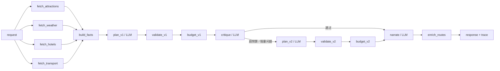

# ADR-001：使用代码定义的确定性 DAG 编排多角色 LLM

- **状态**：Proposed（草稿，Day 2 DAG 测试通过后改为 Accepted）
- **日期**：2026-10-27
- **决策者**：项目作者
- **关联**：[范围冻结](../scope-freeze.md)、[TROUBLESHOOTING 001–004](../../TROUBLESHOOTING.md)
- **取代**：无
- **被取代**：无

---

## 1. 背景

当前系统已经能端到端生成旅行计划：

```text
/api/trip/plan
  -> 景点 Agent / 天气 Agent / 酒店 Agent（三个 SimpleAgent 并行）
  -> Markdown 文本
  -> ContextBuilder 正则抽取
  -> Planner Agent 生成 JSON
  -> 正则解析 TripPlan
  -> BudgetCalculator 用 MySQL 价格库重算
```

它有三个值得保留的资产：

1. **确定性预算**：LLM 选，代码算；`total = 四项之和`。
2. **上下文治理**：`ContextBuilder` 把长文本压缩到 Token 预算内。
3. **MCP 故障排查**：定位过工具未展开、Token 累积、预算幻觉等问题。

但它也有四个结构性问题：

1. **子 Agent 没有决策空间**：`_build_attraction_query()` 已经把 `[TOOL_CALL:...]` 写死，LLM 只是代发固定工具调用。
2. **Markdown → 正则 → 文本不可测**：景点/酒店/天气都从自然语言里抽，字段丢失、格式漂移，近 400 行的 `ContextBuilder` 没有独立测试。
3. **事实由 LLM 写**：Planner 直接写名称、地址、价格、坐标；预算靠名称归一化匹配，镇江以外的城市会静默回退到 LLM 估值。
4. **状态不安全**：Agent 是单例，`clear_history()` 只是补丁；两个并发请求会互相污染 history。

同时，项目约束很明确：

- 8 天、单人、AI 辅助
- 主语言 Java，Python 能读能改
- 只做镇江 1–3 天
- 不加 RAG、不重写 Java、不上 LangGraph
- 目标同时服务 Java 后端与 Agent 工程岗位

---

## 2. 决策

### 2.1 控制面：代码定义 DAG

**DAG 的节点、边、条件、并行、超时、重试、降级全部由代码定义。**

- 图是无环的；不做循环图。
- 最多两次规划 pass：`plan_v1 -> validate -> budget -> critique ->（条件）plan_v2 -> validate -> budget`。
- 是否走 `plan_v2` 由代码判断（`over_budget > 0` 或存在 blocking issue），**不由 LLM 决定**。
- 节点失败语义显式声明：`required` / `optional`。
- 每个节点输出统一 `NodeResult`，并写入 `TraceEvent`。

### 2.2 数据面：LLM 只在三个节点内部工作

| 节点 | 是否 LLM | 职责 | 不做什么 |
|---|---|---|---|
| Planner | 是 | 在候选 ID 中选景点/酒店/餐厅，排每天顺序 | 不写价格、地址、坐标；不决定图 |
| Critic | 是（可选） | 对已生成方案输出结构化 `issues` | 不重写方案；不决定是否重规划 |
| Narrator | 是 | 基于固定事实写日描述/贴士 | 不改 ID、价格、时间；不新增事实 |
| IntentParser | 可选 | 自由文本 → 结构化约束 | 不参与行程生成 |
| 其他节点 | 否 | 取数、校验、预算、渲染、Trace | — |

**一句话边界：代码是控制面，LLM 是数据面；LLM 只做节点内决策，不参与调度。**

### 2.3 事实：ID 化，而不是自然语言

- Tool Layer 返回类型化候选：`AttractionCandidate`、`HotelCandidate`、`RestaurantCandidate`、`TransportFact`、`WeatherFact`。
- 每个候选有稳定 ID（`A001`、`H001`、`R001`）。
- Planner 只输出 ID：

```json
{
  "days": [
    {
      "date": "2026-11-01",
      "attraction_ids": ["A001", "A002"],
      "hotel_id": "H001",
      "meals": [
        {"type": "breakfast", "restaurant_id": "R003"},
        {"type": "lunch", "restaurant_id": "R007"},
        {"type": "dinner", "restaurant_id": "R009"}
      ]
    }
  ]
}
```

- 代码用 ID 展开名称、地址、坐标、门票、营业时间。
- 不存在 ID → Validator 直接拒绝并重试。
- 预算按 ID 查库，不再依赖“金山公园 → 金山寺”的名称归一化。

### 2.4 硬约束与软偏好分离

| 类型 | Owner | 例子 |
|---|---|---|
| 硬约束 | 代码 Validator | ID 存在、天数=日期、每天 2–3 个景点、闭馆日、每日时长 ≤ 8h、预算恒等、酒店晚数 |
| 软偏好 | LLM Planner/Critic | 兴趣匹配、节奏、区域顺序、本地味道 |
| 事实 | 代码 + 数据层 | 门票、坐标、地址、营业时间、人均、交通时长 |
| 叙事 | LLM Narrator | 日描述、贴士、总体建议 |

### 2.5 状态：每次请求一个 TripContext

- 不使用 `SimpleAgent._history` 作为状态源。
- 每次请求创建新的 `TripContext`，节点读写类型化 artifact。
- LLM 调用不带历史消息；多轮编辑未来用 `TripPlan + constraints`，不用聊天记录。
- 并发请求互不影响；这是对现有单例 history 问题的根治。

### 2.6 可观测性：Trace 是一等公民

每个节点记录：

- `node_id`、`status`、`duration_ms`
- `cache`（hit/miss）
- `tokens_in` / `tokens_out` / `cost`
- `error` / `degraded` / `fallback`
- `prompt_version`（LLM 节点）

Trace 返回给前端，渲染成时间线；同时供评测与面试演示使用。

### 2.7 数据与基础设施

- MySQL：景点/酒店/餐厅/交通/知识卡主数据，`source_url + last_verified`。
- Redis：节点缓存、最终计划缓存、幂等键、限流、Trace（可选 TTL）。
- FastAPI：`/api/v1/trips`、`/api/v1/trips/{id}/recalculate`、`/api/v1/graph`、`/health`。
- 前端：镇江首页、结果页、Trace 时间线、预算来源 badge、地图。

### 2.8 目标 DAG



---

## 3. 范围冻结摘要

完整范围见 [范围冻结](../scope-freeze.md)。ADR 只记录与决策相关的边界：

| 维度 | 冻结值 |
|---|---|
| 城市 | 镇江（单城市） |
| 天数 | 1–3 天（API 可接受 1–7，评测聚焦 1–3） |
| 主题 | 历史文化、美食、自然、亲子、摄影、宗教 |
| 数据 | 18 景点 / 10 酒店 / 12 餐厅 / 8 交通 / 12 知识卡 |
| 预算 | 可选；代码计算，LLM 不算 |
| 交通 | 公共交通 / 步行 / 打车 / 自驾 |
| 不做 | 多城市、RAG、Java 重写、LangGraph、登录支付、实时库存 |

**变更控制**：Day 1–7 不新增功能；任何架构变更先改本 ADR，再改代码。

---

## 4. 结果

### 4.1 正面

- LLM 调用从“3 个固定工具调用 + 1 个 Planner”变成正常 **2 次**（Planner + Narrator），需要评审时最多 4 次。
- Prompt Token 目标从约 24k 降到 **6–10k/次**。
- 事实、价格、坐标、营业时间由代码/数据层保证，幻觉面大幅缩小。
- 预算恒等式、闭馆日、每日时长等硬约束可单测。
- 并发安全：无共享 Agent history。
- Trace 让“省了多少 Token、慢在哪、哪一步降级”可展示、可评测。
- 面试叙事更清晰：确定性编排 + 有边界的 LLM + 评测。

### 4.2 负面

- 需要自己写 DAG 执行器与节点契约，代码量比“调 Agent 框架”多。
- 需要维护镇江数据集；数据质量成为项目上限。
- LLM 生成的文字仍然不是完全确定；只能保证结构、事实和约束。
- 需要补评测；否则无法证明“比单次 LLM 更好”。
- 旧链路要逐步退役，存在一段时间两套代码并存。

### 4.3 中性

- 不引入 LangGraph 等框架，减少黑盒，但失去现成的 checkpoint/streaming。
- Python 实现，但接口保持 Java 友好；后续可映射到 Spring Boot。

---

## 5. 备选方案

| 方案 | 优点 | 不采用的原因 |
|---|---|---|
| 继续用 3 个 SimpleAgent | 改动最小，现有代码可复用 | 子 Agent 无决策；Markdown/正则不可测；并发不安全 |
| 全部交给单次 LLM 调用 | 调用少、实现快 | 没有工具事实、预算和硬约束保证 |
| LangGraph | 有状态、checkpoint、streaming | 图是静态的；8 天不需要；多一层黑盒 |
| 让 LLM 直接 tool calling | 灵活、Agent 味足 | 数据获取是确定的；增加延迟/成本/方差；MCP 每次调用起子进程 |
| 加 RAG | 可做文化问答 | 任务不匹配；结构化数据用 SQL 更准；评测成本高 |
| Java 重写 | 贴合主语言 | 8 天不够；LLM/MCP 生态 Python 优先；架构可移植 |

---

## 6. 风险与缓解

| 风险 | 影响 | 缓解 |
|---|---|---|
| 数据价格/时间不准 | 预算与行程不可信 | `source_url` + `last_verified`；不确定标“待核实”；README 免责声明 |
| 8 天做不完 | 半成品 | Walking skeleton 优先；Day 1 先跑通无 LLM 链路；可选功能随时砍 |
| Python 不熟 | 代码质量差 | 2 小时最小集；类型注解 + Pydantic + pytest；每模块写 5 行笔记 |
| LLM 输出非法 JSON | 请求失败 | JSON Schema + 重试 1 次 + 真实数据保底；不返回假行程 |
| 并发串数据 | 结果污染 | 每次请求独立 `TripContext`；无全局 Agent history；并发测试 |
| MCP 每次调用起子进程 | 延迟高 | 主链路用本地库 + 高德 REST；MCP 作为可选 Provider |
| 评测主观 | 无法证明效果 | 确定性指标为主（ID 幻觉、预算恒等、约束通过率）+ 人工 rubric |
| 范围膨胀 | 延期 | 本文档 + 范围冻结；新增功能必须砍一个 |

---

## 7. 待定问题（Day 1 不阻塞）

- [ ] Redis 是否在 Day 4 必做，还是可选？（倾向：必做缓存/幂等，限流可选）
- [ ] Critic 是每次调用还是条件调用？（倾向：条件调用，超预算/软评分低才调用）
- [ ] 保底 Planner 的规则范围？（倾向：must-see + 区域聚类 + 最近邻）
- [ ] CI 用 MySQL 还是 SQLite/fake repository？（倾向：单测 fake，集成测试本地 MySQL）
- [ ] Trace 是否持久化到 Redis？（倾向：响应内返回 + 可选 Redis TTL）
- [ ] Planner/Narrator 的模型选择？（倾向：Planner 强模型 temp 0，Narrator 便宜模型 temp 0.4）

这些问题的答案在 Day 2–4 的代码和测试中确定，并在本 ADR 的 Change Log 追加。

---

## 8. 验收标准

- **Day 2**：DAG 执行器单测通过（拓扑、并行、超时、重试、失败隔离、循环检测）。
- **Day 3**：5 条真实请求跑通；无假行程；非法 ID 被拒绝；预算恒等。
- **Day 4**：两个并发请求不串数据；缓存/幂等/限流可用；`/health` 正常。
- **Day 6**：15 条评测 + 单次 LLM 基线；报告写入 `eval/report.md`。
- **Day 8**：3 分钟 Demo 能讲清“代码控制面 + LLM 数据面”。

---

## 9. 参考资料

- [范围冻结](../scope-freeze.md)
- [TROUBLESHOOTING](../../TROUBLESHOOTING.md)：MCP 工具未展开、Token 累积、预算幻觉、并行改造
- 当前实现：`backend/app/agents/trip_planner_agent.py`、`backend/app/services/context_builder.py`、`backend/app/services/budget_calculator.py`
- 目标结构：`backend/app/domain/`、`backend/app/dag/`、`backend/app/tools/`、`backend/app/api/v1/`

---

## 10. Change Log

| 日期 | 变更 | 作者 |
|---|---|---|
| 2026-10-27 | 初稿：冻结范围、确定 DAG/LLM 边界、记录备选方案与风险 | 项目作者 |
