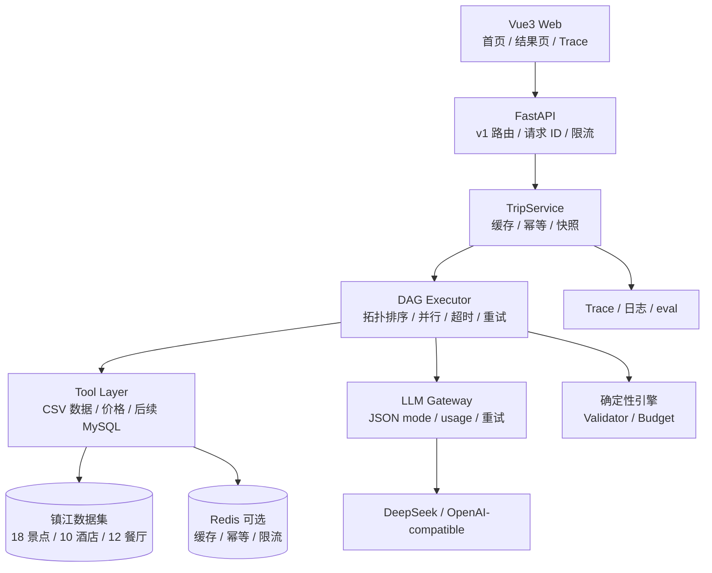
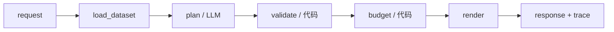

# 架构：确定性 DAG + 多角色 LLM

> 一句话：**代码是控制面，LLM 是数据面。**
> 代码决定图怎么走、哪些事实进入行程、钱怎么算；LLM 只在少数节点里做取舍和表达。

相关文档：

- [范围冻结](./scope-freeze.md)
- [ADR-001：确定性 DAG](./adr/001-deterministic-dag.md)
- [评测报告](../eval/report.md)

---

## 1. 系统总览



设计要点：

1. **API 层只做接入**：参数校验、`X-Request-ID`、限流、幂等，不写行程逻辑。
2. **TripService 管请求级状态**：计划缓存、幂等键、行程快照、重算；每个请求独立 `TripContext`。
3. **DAG 执行器管控制流**：节点、边、并行、超时、重试、失败隔离、Trace。
4. **LLM 只在决策节点工作**：不决定图，不查数据，不算钱，不写事实字段。

---

## 2. DAG



当前生产路径是 5 个节点。日常评测中的 `rule` 基线把 `plan` 换成 `fake_plan`，其余节点不变。

| 节点 | 类型 | 输入 | 输出 | 失败语义 |
|---|---|---|---|---|
| `load_dataset` | 代码 | request | `Facts`（候选 ID） | 必需，失败 502 |
| `plan` | LLM | facts + 用户偏好 | `PlanDraft`（只含 ID） | 重试 1 次，仍失败抛错 |
| `validate` | 代码 | plan + facts | `ValidationResult` | blocking 失败则中断 |
| `budget` | 代码 | plan + 价格 | `BudgetReport` | 预算恒等由代码保证 |
| `render` | 代码 | 全部 | `TripResult` | 必需 |

**不做循环图**。未来需要“预算内二次规划”时，用两次固定 pass：

```text
plan_v1 -> validate -> budget -> critique
  -> 条件成立：plan_v2 -> validate -> budget
  -> 条件不成立：render
```

条件边由代码判断（`over_budget > 0` 或存在 blocking issue），LLM 不决定走哪条边。

---

## 3. LLM 的职责边界

| 节点 | 是否 LLM | 负责 | 不负责 |
|---|---|---|---|
| `plan` | 是 | 从候选 ID 中选择景点/酒店/餐厅，排每天顺序 | 不写价格、地址、坐标；不决定图 |
| `validate` | 否 | ID 存在、闭馆日、每日时长、三餐、预算恒等 | — |
| `budget` | 否 | 按 ID 查价、回写明细、汇总 | — |
| `render` | 否 | 把 ID 展开成响应 | — |

当前 `critic` / `narrator` 是后续扩展位：

- `critic`：只输出结构化 `issues`，不重写方案。
- `narrator`：只基于固定事实写描述/贴士，不改 ID/价格。
- 两者都由代码决定是否调用、是否重规划。

---

## 4. 为什么 Planner 只输出 ID

```json
{
  "days": [
    {
      "date": "2026-11-14",
      "attraction_ids": ["A001", "A002"],
      "hotel_id": "H002",
      "meals": [
        {"type": "breakfast", "restaurant_id": "R004"},
        {"type": "lunch", "restaurant_id": "R002"},
        {"type": "dinner", "restaurant_id": "R008"}
      ]
    }
  ]
}
```

代码用 ID 展开名称、地址、坐标、门票、时长。这样：

- 不存在 ID → Validator 拒绝，Planner 重试；
- 价格不会被编造 → Budget 按 ID 计算；
- 名称不需要模糊归一化；
- 前端只展示代码确认过的事实。

这就是“LLM 负责选，代码负责算”的具体落地。

---

## 5. 硬约束 vs 软偏好

| 类型 | Owner | 例子 |
|---|---|---|
| 硬约束 | `validate` + `budget` | ID 存在、天数=日期、每天 2–3 景点、闭馆日、每日 ≤ 8h、预算恒等、酒店晚数 |
| 软偏好 | LLM Planner | 兴趣匹配、节奏、区域顺序、本地味道 |
| 事实 | 数据层 | 门票、坐标、地址、开放时间、人均、交通时长 |
| 叙事 | 后续 Narrator | 日描述、贴士、总体建议 |

一句话：**LLM 在可行解里挑更好的解，代码保证解一定可行。**

---

## 6. 请求级状态与并发

```python
class TripContext:
    request: TripRequest
    facts: Facts | None
    plan: PlanDraft | None
    validation: ValidationResult | None
    budget: BudgetReport | None
    trace: list[TraceEvent]
    degraded: bool
```

- 每个请求 new `TripContext`；
- Planner 不携带跨请求 history；
- `TripService` 只共享无状态的 planner / cache，不共享上下文；
- 并发测试：两个不同日期的请求同时执行，日期和预算不串。

---

## 7. 缓存、幂等、限流

| 用途 | Key | 默认 TTL | 后端 |
|---|---|---|---|
| 计划缓存 | `plan:{request_hash}` | 1h | Redis / Memory |
| 幂等 | `idem:{Idempotency-Key}` | 10min | Redis / Memory |
| 限流 | `rate:{ip}:{minute}` | 60s | Redis / Memory |
| 行程快照 | `trip:{trip_id}` | 1h | Redis / Memory |

未配置 `REDIS_URL` 时自动使用单进程 `MemoryCache`，所以本地无 Redis 也能跑；多 worker 部署需要 Redis。

---

## 8. 失败语义

| 失败 | 行为 |
|---|---|
| 数据集结构不合法 | `load_dataset` 失败，整体 502 |
| Planner JSON 非法 | 带校验错误重试 1 次；仍失败则抛错，**不返回假行程** |
| Planner 未知 ID / 闭馆日 | 同上，重试后失败 |
| Validator blocking | 整体失败，返回问题列表 |
| 预算库不可用 | 回退 CSV/默认值，标记来源 |
| 地图/图片失败 | 前端降级，不影响文字行程 |
| 网络/超时 | 基础设施失败，单独统计，不伪装成功 |

**没有“城市景点1”这种假兜底。**

---

## 9. 为什么不用 RAG / LangGraph / Java 重写

### 不用 RAG

旅行规划的瓶颈是**结构化候选、价格、约束、工具可靠性**，不是文档检索。  
镇江 18 个景点、12 家餐厅用 SQL/CSV 按 ID 查，比向量检索更准、更便宜、可解释。  
如果未来做“镇江文化问答”，再用知识卡/检索；主链路不需要。

### 不用 LangGraph

图是静态的 5 个节点；手写 200 行 DAG 可以清楚讲拓扑排序、并行、超时、重试、失败隔离，也方便移植到 Java。  
LangGraph 的 checkpoint/streaming 对这个项目不是刚需。

### 不用 Java 重写

主语言是 Java，但 LLM 生态 Python 优先；8 天里重写会牺牲项目深度。  
架构是接口化的，DAG Executor / Pydantic / FastAPI / Redis / MySQL 都可以映射到 Spring Boot：

| 本项目 | Java / Spring |
|---|---|
| `Graph` / `DAGExecutor` | `CompletableFuture` / StateMachine |
| Pydantic `BaseModel` | DTO + Jakarta Validation |
| FastAPI Router | Spring MVC |
| `Depends` | Spring DI |
| Redis Cache | Spring Data Redis |
| CSV/MySQL Repository | MyBatis / JPA |
| pytest | JUnit 5 |

---

## 10. 评测

[eval/report.md](../eval/report.md) 记录：

- 15 条镇江 case；
- 当前 DAG + LLM、规则保底、单次 LLM 三个系统；
- 指标：结构合法率、must-see 覆盖、ID 幻觉率、预算恒等、超预算率、P50/P95、Token。

当前结果：

```text
当前 DAG + LLM: 15/15 结构合法，must-see 100%，ID 幻觉 0%，平均 6.3k Token
规则保底:        15/15 结构合法，must-see 54.4%，零 Token
```

规则保底证明“校验 + 预算”链路本身是通的；LLM 的增益体现在偏好匹配。
